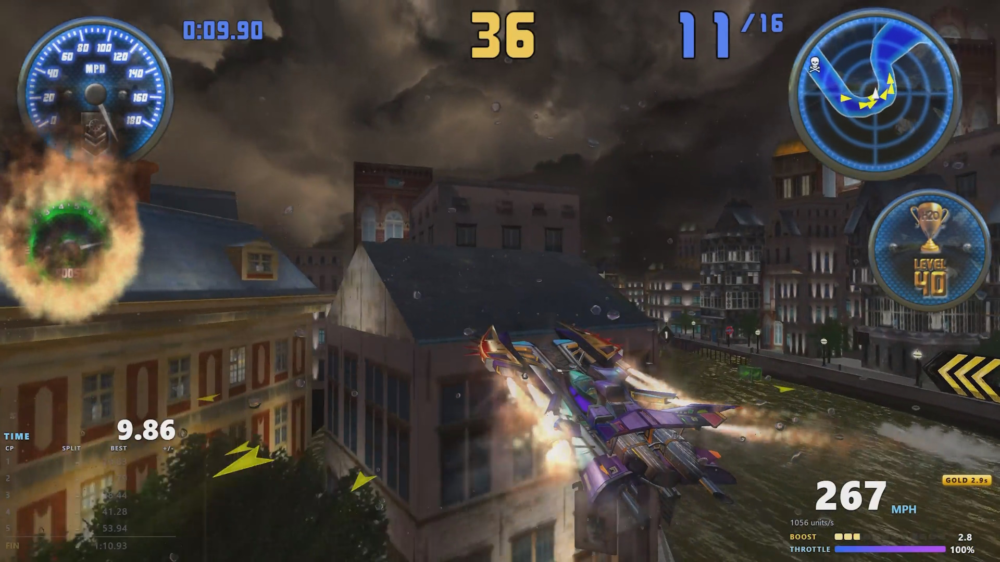
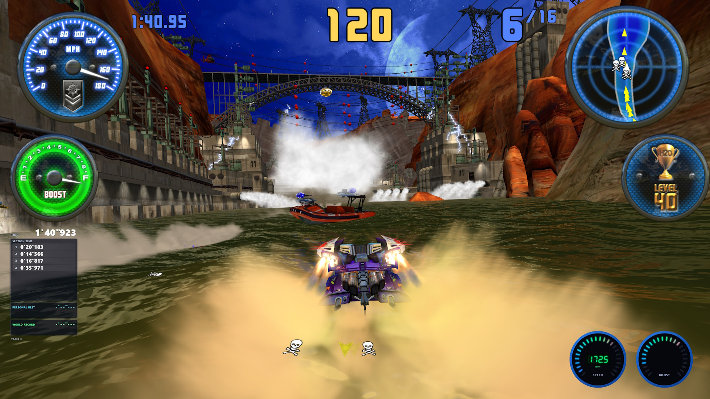

# Project H2O

Project H2O is an emulation package, built on OpenParrot, that aims to be the definitive way to experience H2Overdrive at home.

### Features

Provided by OpenParrot-H2O:

- Resolution patch
- Framerate limiter (60 FPS)
- Borderless windowed
- Force quit key (default: `F12`)

Provided by H2ODashboard:

- Emulate the physical gauges on the H2Overdrive cabinet
- Use custom skins
- Display detailed info such as true speed and boost values
- User-defined split timers
- Compatible with OBS

### Usage

Download the latest `ProjectH2O.zip` from the [Releases](../../releases/latest) and extract it.

Usage is the same as standard TeknoParrot. Add the game to your library, bind your controls and settings, then launch it.

To use H2ODashboard, simply open `H2ODashboard/H2ODashboard.exe` and it should connect to the game automatically. Further instructions are in the window.

For more information on creating custom H2ODashboard skins, see the documentation in the [H2ODashboard repo](https://github.com/ProjectH2O/H2ODashboard).

### Screenshots

With H2ODashboard `splits` panel and `speedrun` skin:

With H2ODashboard `timeattack` panel and `cabinet` skin:

To set a custom WR time, edit `H2ODashboard.wr.ini` in a text editor.

### Issues

If you encounter any issues with Project H2O, you can open an issue report. Be sure to include relevant details and screenshots of the problem, if possible.

### Contributing

Feel free to open any feature requests or pull requests that you think might be helpful.

### Special thanks

[Project Asakura](https://github.com/ProjectAsakura) - an inspiration for Project H2O.
